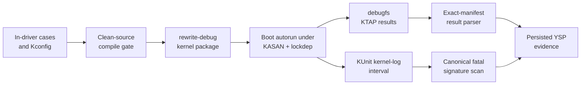

# How the rewrite drivers use KUnit

The rewrite drivers use KUnit as a built-in boot gate for logic and state
transitions that can be exercised without RK3588 hardware. The YSP result is
green only when the named **111 MPP + 152 RGA case manifest** matches without
duplicates, omissions, failures, or skips **and** the same kernel-log interval
is free of sanitizer reports, warnings, lockdep findings, refcount failures,
and media/IOMMU faults. The report also binds the run to the kernel release,
source commit, configuration hash, and installed package.

This is a compound contract. Green KTAP alone is insufficient: a case can
return `ok` after provoking a KASAN report or kernel warning.



For the broader testing ladder and the boundary between unit and hardware
evidence, see the
[observability and testing architecture](rewrite-driver-architecture/05-observability-and-testing.md)
and the [rewrite validation plan](rewrite-validation-plan.md). The proposed
[KUnit rationalization and fixture-hardening plan](rewrite-kunit-rationalization-plan.md)
defines how to retain the high-value contracts while removing production
singleton reuse, making resource cleanup failure-safe, relocating redundant
checks, and consolidating repeated vectors.

## Source organization

Each suite is compiled in the same translation unit as its driver:

| Suite | Source | Kconfig symbol | Registered cases |
|-------|--------|----------------|-----------------:|
| `rk_mpp_rewrite` | `drivers/video/rockchip/mpp-rewrite/mpp_rewrite.c` | `CONFIG_ROCKCHIP_MPP_REWRITE_KUNIT_TEST` | 111 |
| `rockchip-rga-rewrite` | `drivers/video/rockchip/rga-rewrite/rga_rewrite.c` | `CONFIG_ROCKCHIP_RGA_REWRITE_KUNIT_TEST` | 152 |

The test blocks are guarded with `IS_ENABLED()` and registered with
`kunit_test_suite()`. Keeping the cases beside the implementation lets them
exercise static parsers, validators, register emitters, state machines, and
lifetime helpers without exporting internals or adding test-only production
hooks. A production configuration without the test symbols compiles those
blocks out.

Built-in KUnit does not execute a suite from KUnit's own late initcall. Linux
finishes all initcalls in `do_basic_setup()`, then
`kernel_init_freeable()` calls `kunit_run_all_tests()`, and only afterward
waits for initramfs. Each rewrite driver therefore registers normally at
device-initcall time. The suites must coexist with those already-probed
production services: every stateful fixture now creates its own service
instance, and no suite callback unregisters, reprobes, or reinitializes the
runtime.

Both test symbols depend on their rewrite driver and `KUNIT`; they default to
`n` even when `KUNIT_ALL_TESTS=y` because they remain large, embedded lifecycle
qualification suites rather than ordinary unit-test defaults. A qualification
build must select both explicitly. A boot used as YSP evidence must have all of
these resolved to `y`:

```text
CONFIG_KUNIT=y
CONFIG_KUNIT_DEBUGFS=y
CONFIG_KUNIT_DEFAULT_ENABLED=y
CONFIG_KUNIT_AUTORUN_ENABLED=y
CONFIG_ROCKCHIP_MPP_REWRITE=y
CONFIG_ROCKCHIP_MPP_REWRITE_KUNIT_TEST=y
CONFIG_ROCKCHIP_RGA_REWRITE=y
CONFIG_ROCKCHIP_RGA_REWRITE_KUNIT_TEST=y
```

The vendor MPP/RGA drivers and the rewrite drivers own the same device nodes,
so the rewrite debug flavor also disables `ROCKCHIP_MPP_SERVICE`,
`ROCKCHIP_MULTI_RGA`, and `VIDEO_ROCKCHIP_RGA`.

An ordinary object build can silently omit thousands of lines of KUnit code
when the tree's `.config` selects the vendor driver instead. A valid compile
claim therefore records the resolved symbols, not just a successful
`mpp_rewrite.o` or `rga_rewrite.o` target.

## What the suites cover

The cases are intentionally grouped around risky boundaries rather than
hardware throughput:

| Driver | Case region | Main subjects |
|--------|-------------|---------------|
| MPP | 1–26 | Message parsing, topology, AV1 layout/metadata/AFBC observation and admission, register and DMA bounds |
| MPP | 27–48 | RKVDEC2 CCU modes, link descriptors/tables, ownership, RCB/cache setup |
| MPP | 49–67 | Activation claims, typed external activation/job reference ownership, exact clean/recovered terminal observations, IRQ ownership, scheduling, IOMMU faults, timeout generations, recovery, and explicit IOVA affinity |
| MPP | 68–79 | Polling, encoder slices, bitstream overflow, DCHS, watchdogs, and RCB validation |
| MPP | 80–98 | Sessions, batch operation, imports, polling, abort/close teardown, event ring, and request-configuration cleanup |
| MPP | 99–105 | Cluster topology/DMA/recovery/reset and reset-domain registry/state |
| RGA | 1–20 | Feature validation and RGA2/RGA3 register emission |
| RGA | 21–44 | Request parsing, ioctls, job state, and file lifetime |
| RGA | 45–61 | Imports, fences, layouts, planes, offsets, and strides |
| RGA | 62–80 | Import identity, DMA ownership, and job lifetime |
| RGA | 81–101 | Abort/recovery, scheduling, IOMMU routes, faults, and timeouts |
| RGA | 102–148 | FFmpeg, GStreamer, RKNN, librga, and display-shaped format/emission profiles |
| RGA | 149–152 | RGA3 overlap-copy rotate emission, the RGA2 validator-chain exclusions, the RGA2 internal-MMU sgt/layout/emit cases, and the rejection event ring |

The case regions are approximate. They were last aligned at the 105/152
manifest, and cases added or removed since change the middle of the list, so
later ordinals shift: `rewrite-kunit-manifest.tsv` is the authority for order.
The 2026-11-22 review fixes added `rk_mpp_job_write_regs_owned_words_kunit`
(MPP 34), `rk_mpp_session_poll_irq_nonblock_last_kunit` (MPP 97),
`rk_mpp_hw_abort_defers_to_frame_kunit` (MPP 100),
`rk_rga2_line_irq_ack_kunit` (RGA 5),
`rk_rga2_envelope_backend_mask_kunit` (RGA 63),
`rk_rga_queue_on_suspended_hw_kunit` (RGA 82), and
`rk_rga_userptr_shadow_zeroed_kunit` (RGA 88); those ordinals are the ones in
the current 111/152 manifest.

The 2026-11-23 case-by-case audit removed five low-value cases: MPP
`rk_mpp_support_cmds_kunit` (was MPP 4), and RGA `rk_rga_fill_hw_type_kunit`
(was RGA 4), `rk_rga2_fill_dst_offset_emit_kunit` (was RGA 5; its one unique
assertion moved into `rk_rga2_rectangle_task_emit_kunit`),
`rk_rga_request_remove_free_kunit` (was RGA 45), and `rk_rga_irq_flags_kunit`
(was RGA 53). Every ordinal after a removed case moved down. The
[first-execution finding](../../findings/2026-11-23-rewrite-kunit-first-execution-fixture-repair-and-case-audit.md)
records the audit.

These are white-box cases. They call production functions with controlled fake
objects and assert outputs, state transitions, ownership, and error behavior.
The debug kernel then runs those same calls under KASAN, UBSAN checks, lockdep,
debug objects, refcount checking, and the other instrumentation selected by
[`ysp-debug-instrumentation.conf.sh`](../scripts/debug-kernel/ysp-debug-instrumentation.conf.sh).

## Fixture contract

A fake object must satisfy every invariant the production path would have
established before calling the function under test. In particular:

- initialize list heads, locks, waitqueues, completions, refcounts, and
  work/timer objects before any path can observe them;
- connect jobs, hardware objects, cores, sessions, and imports exactly as
  probe, open, or submission would;
- build every MPP `struct rk_mpp_hw` fixture with `rk_mpp_kunit_alloc_hw()` or
  `rk_mpp_kunit_hw_init()`, never by hand. Both call
  `rk_mpp_hw_state_init(hw, coordinator)`, the function probe uses for a
  hardware object's reference count, completion, mutexes, spinlocks, lists,
  and work items, and both register cancellation of the object's work items.
  A member probe starts initialising is then initialised in every fixture. The
  constructor does not set `hw->srv`, `hw->match`, or `hw->dev`; a case sets
  those, its register windows, and any reference count other than probe's.
  Because the object carries initialised work items, it belongs in
  KUnit-managed memory, not on the stack;
- take fixture locks in the driver's order. Lockdep gives each
  `mutex_init()`/`spin_lock_init()` call site its own lock class, so
  hand-initialised fixture locks were unrelated to one another and to the
  driver's ordering rules, and a reversed order went unreported. Fixtures
  built through the shared constructor use the driver's classes, including
  the separate classes probe gives a coordinator, so lockdep compares every
  case against every other. The coordinator's `ccu_recovery_lock` is taken
  before a core's `run_lock`. The RGA fixtures still build `struct rk_rga_hw`
  by hand and do not have this property;
- mark reset-less fake hardware `terminally_stopped` when a case is not meant
  to exercise a real recovery backend;
- pair `INIT_WORK_ONSTACK()` or `INIT_DELAYED_WORK_ONSTACK()` with the matching
  destroy helper before the test returns;
- prefer KUnit-managed allocation and cleanup actions for objects that can
  escape the immediate assertion path;
- give every fixture job that will be released a service (`session->srv`) and
  an initialised activation;
- let the running test own direct-emitter RGA fixture plans, so their
  allocations are released with the test (before 2026-11-23 they left 101
  kmemleak objects per run);
- initialize error outputs before testing validation failures; and
- update stale expected register values or allocator behavior when the
  documented ABI changes—do not weaken a production validator merely to keep
  an old fixture green.

The focused build gate runs
[`rewrite-kunit-source-audit.py`](../tests/rewrite-kunit-source-audit.py)
against every block guarded by either rewrite KUnit symbol before compiling.
Its checked
[`rewrite-kunit-source-audit-baseline.tsv`](../tests/rewrite-kunit-source-audit-baseline.tsv)
records the current lexical fixture-debt signals. Removing a signal passes;
adding singleton access, FD/raw allocation, a stack async owner, a manual list
link, or a fatal assertion after acquisition but before cleanup registration
fails. Project wrappers such as `kzalloc_obj()` and
`rk_rga_fence_create_fd()` are included. This is a regression guard and
inventory aid, not proof that baselined fixtures are safe.

Warnings are fixture failures too. Unbalanced preemption/IRQ state, an active
stack work item, a refcount warning, or a debug-object complaint invalidates the
run even if every assertion produced `ok`.

The 2026-07-26 first full boot exposed exactly this distinction. All 232 cases
ran, but incomplete fixtures and six real driver-contract defects produced
failed assertions, Oopses, KASAN reports, debug-object warnings, refcount
warnings, and IRQ/preemption imbalance. The
[root-cause record](../../findings/2026-07-26-rewrite-kunit-failure-root-causes.md)
documents each cause and repair.

The 2026-07-27 follow-up also showed why a source sweep must accompany the
warning scan: `debug_object_is_on_stack()` prints only five stack-annotation
mismatches per boot. The first five reports hid three later objects, including
both halves of a delayed work in the timeout-replacement fixture. After the
first fixtures moved off-stack, the next boot exposed that final pair. See the
[capped-fixture record](../../findings/2026-07-27-rewrite-kunit-final-stack-fixture.md).

## Build and boot path

The device-free gate builds committed source exported with `git archive`, so
generated files or stale objects in a developer worktree cannot conceal a
failure:

```bash
REWRITE_BUILD_PROFILES='normal test-disabled memory race' JOBS=8 \
  bash kernel-drivers/tests/rewrite-build-gate.sh all

REWRITE_BUILD_PROFILES=test-disabled VERIFY_ABI_STATIC_ASSERT=1 JOBS=8 \
  bash kernel-drivers/tests/rewrite-build-gate.sh all
```

The profiles build both rewrite objects, the Rockchip IOMMU provider, and the
Rock 5B DTB. Before compiling, the `all` gate compares both maintained trees'
rewrite sources, Kconfig, ABI ledgers, and MPP UAPI byte-for-byte and audits
their KUnit signals in one invocation. `test-disabled` proves no KUnit-only
dependency leaked into the production object; `memory` adds KASAN and
fault-injection options; `race` adds KCSAN and lockdep. The optional mutation
check proves the ABI constants remain compile-time-owned. These four are
**compile profiles**—success proves that the selected code builds
warning-free, not that KUnit ran.

A fifth profile, `kunit-run`, does execute the suites: it calls
[`rewrite-kunit-qemu.sh`](../tests/rewrite-kunit-qemu.sh) on each tree, in the
same per-branch build directory a by-hand run uses, as described under
[Executing the suites in a KVM guest](#executing-the-suites-in-a-kvm-guest).
Since 2026-11-24 the gate's default `REWRITE_BUILD_PROFILES` is
`normal kunit-run` (it was `normal`), so a default gate run needs QEMU and
read/write access to `/dev/kvm`. A fixture that has fallen behind the driver
then fails the gate at the commit that broke it.

Build the bootable KASAN/lockdep flavor with:

```bash
ARMBIAN_USE_CCACHE=yes \
  bash kernel-drivers/scripts/build-kernel.sh rewrite-debug
```

The flavor configuration in
[`config-rock5b-rewrite-debug-kernel.conf.sh`](../scripts/debug-kernel/config-rock5b-rewrite-debug-kernel.conf.sh)
forces both drivers and suites built-in. KUnit autorun executes them during
boot. The suites use local service instances and do not unregister, reprobe, or
reinitialize the production MPP/RGA services. Install and recover through the
[debug-kernel runbook](debug-kernel.md), then verify the booted release and
configuration through the
[kernel validation runbook](kernel-validation-runbook.md).

## Executing the suites in a KVM guest

[`rewrite-kunit-qemu.sh`](../tests/rewrite-kunit-qemu.sh) executes both suites
in a virtual arm64 `virt` machine. It needs no package, no reboot of the
board, and no root:

```bash
bash kernel-drivers/tests/rewrite-kunit-qemu.sh <kernel-tree>
KUNIT_QEMU_KASAN=1 \
  bash kernel-drivers/tests/rewrite-kunit-qemu.sh <kernel-tree>
KUNIT_QEMU_RAW_NESTING=1 \
  bash kernel-drivers/tests/rewrite-kunit-qemu.sh <kernel-tree>
bash kernel-drivers/tests/rewrite-kunit-qemu.sh --install-qemu
```

The script exports the committed `HEAD` of `<kernel-tree>` into a scratch
source tree, gives that tree's own `tools/testing/kunit/kunit.py` a minimal
kunitconfig, builds the kernel out of tree, and boots it under QEMU with KVM.
The configuration selects both rewrite drivers and both suites, the Rockchip
and VSI IOMMU providers, `PROVE_LOCKING`, `DEBUG_ATOMIC_SLEEP`,
`DEBUG_OBJECTS` with work, timer, and free tracking, and `DEBUG_LIST`, and
leaves the vendor MPP/RGA drivers off. Trailing arguments are passed to
`kunit.py` as filter globs.

- **Source.** `<kernel-tree>` is a git checkout of a rewrite line. What runs
  is its committed `HEAD`: uncommitted changes are ignored and the checkout is
  not touched. The export uses a private index and a persistent scratch tree,
  so an unchanged file keeps its timestamp and the rebuild is incremental. A
  checkout that holds in-tree build output needs no manual export.
- **Acceleration.** `KUNIT_QEMU_ACCEL` is `kvm` (default) or `tcg`. `kvm`
  needs read/write access to `/dev/kvm` (membership of the `kvm` group) and
  fails rather than fall back: `kunit.py` lists KVM first and falls back
  silently, so the script also fails when the console lacks
  `KVM: hypervisor services detected`. `tcg` is software emulation.
- **CPU pinning.** Under `kvm` the guest is pinned to the host's
  largest-capacity CPU cluster, the four Cortex-A76 cores (host CPUs 4–7) on
  this board, and gets one guest CPU per pinned core. KVM does not support a
  guest CPU migrating between unlike cores of a big.LITTLE SoC, so the pin is
  not optional here. Only the guest is pinned; the kernel builds on every
  core. `KUNIT_QEMU_SMP` overrides the guest CPU count, which is 2 under
  `tcg`.
- **Lockdep configuration.** By default the script builds the way the debug
  kernel does: it applies the same
  [locknest prompt patch](../patches/debug-kernel/0002-lockdep-make-PROVE_RAW_LOCK_NESTING-prompt-uncondit.patch)
  to the exported tree and turns `PROVE_RAW_LOCK_NESTING` off, so lockdep
  stays alive for the whole run and a pass means lockdep saw every case.
  `KUNIT_QEMU_RAW_NESTING=1` leaves the checker on; that is the mode the
  [minimal hard-IRQ plan](rewrite-minimal-hard-irq-plan.md) uses for its exit
  gates.
- **KASAN.** `KUNIT_QEMU_KASAN=1` adds generic KASAN as a separate, slower
  build.
- **QEMU.** `qemu-system-aarch64` is taken from `PATH`, or from the unpacked
  copy under `KUNIT_QEMU_ROOT` (default
  `../rock-5b/build/qemu-userland/root`). `--install-qemu` creates that copy
  without root: it downloads the distribution packages with `apt download`
  and unpacks them with `dpkg -x`.
- **Output.** Everything goes to `KUNIT_QEMU_BUILD_DIR`, by default
  `../rock-5b/build/rewrite-kunit-qemu/<label>`, where the label is
  `KUNIT_QEMU_LABEL` or the branch name. The exported source, one output
  directory per instrumentation variant, and the console log
  (`console-nest<0|1>-kasan<0|1>.log`) live there. The compiler cache is the
  shared `~/Code/.ccache`.
- **Exit status.** `0` when every case passes and the console is quiet;
  `kunit.py`'s status when a case fails; `3` when every case passes but the
  console holds a kernel warning, lockdep report, or sanitizer report; `4`
  when lockdep was turned off during the run.

The build gate's `kunit-run` profile calls this script with its defaults; see
[Build and boot path](#build-and-boot-path). Do not run two instances for the
same branch at once: they share one exported source tree.

A clean run shows that every registered case passes on that source and that
the console stays quiet under the selected instrumentation, with lockdep
still enabled at the end. KVM adds speed and real concurrency on four cores
and nothing else: it is still a `virt` machine, not the board, and a clean
run does not satisfy the compound gate:

- no RK3588 device, interrupt, or IOMMU exists on the `virt` machine, so the
  production services the suites must coexist with on the board are absent,
  and the cases touch only their own fixtures;
- the kernel is not the `rewrite-debug` package and does not carry its full
  instrumentation set; in particular the script has no kmemleak mode, and the
  2026-11-23 kmemleak verdict came from a separate untracked init on the
  KASAN kernel;
- the run does not compare case names against `rewrite-kunit-manifest.tsv`,
  and its console scan is a short fixed pattern list, not
  `SUITE_DMESG_FATAL_RE`; and
- nothing binds the result to an installed package or a board boot interval.

Use it to find fixture failures before spending a package build and a board
boot on them. The compound boot gate below is still required.

## Reading the boot result

With debugfs mounted, KUnit exposes the most recent result for each suite:

```text
/sys/kernel/debug/kunit/rk_mpp_rewrite/results
/sys/kernel/debug/kunit/rockchip-rga-rewrite/results
```

These are generated debugfs files. They commonly report a size of zero through
`stat` while returning complete KTAP when read. Test readability with `-r` or
read the file directly; do not use `-s` as a presence check.

The YSP parser encodes the exact pass contract:

```bash
sudo bash kernel-drivers/tests/rewrite-kunit-log-check.sh
```

For each suite it requires:

| Field | Required value |
|-------|----------------|
| Inner KTAP plan | exactly 111 MPP or 152 RGA |
| Observed case results | exactly the planned count |
| Failed cases | 0 |
| Skipped cases | 0 |
| Suite summary | `ok` |
| Ordered names | exactly the case list `rewrite-kunit-manifest.tsv` names, in that order; a mismatch is reported as added/missing case names |
| Source identity | 12–40 digit commit, also embedded as `-g<commit>` in `uname -r` or ` g<commit>` in `uname -v` |
| Configuration | SHA-256 of the booted kernel config |
| Package | installed image package name and version |

The checker extracts the complete boot KUnit interval beginning at the outer
KTAP header and plan, before either suite initializer can log, through the
final RGA suite result. It scans that interval through
`SUITE_DMESG_FATAL_RE` from
[`suite-common.sh`](../tests/suite-common.sh), and requires
`/proc/sys/kernel/debug_locks` to remain `1`. Missing/incomplete log access, a
fatal match, or disabled lockdep fails the compound gate even when every KTAP
assertion reports `ok`. The expression remains shared so new sanitizer and
Rockchip IOMMU fault signatures cannot drift between suites.

## Capture a reproducible result

Run these commands from the YSP repository after booting the rewrite debug
kernel. Evidence belongs in the external conformance workspace, not in Git:

```bash
run_id=$(date -u +%Y%m%dT%H%M%SZ)
evidence="../rock-5b/build/rockchip-conformance/logs/rewrite/$run_id-kunit"
mkdir -p "$evidence"

uname -a > "$evidence/uname.txt"
sudo cp "/boot/config-$(uname -r)" "$evidence/config"
sudo cat /sys/kernel/debug/kunit/rk_mpp_rewrite/results \
  > "$evidence/rk_mpp_rewrite.ktap"
sudo cat /sys/kernel/debug/kunit/rockchip-rga-rewrite/results \
  > "$evidence/rockchip-rga-rewrite.ktap"

package_name=$(dpkg-query -S "/boot/vmlinuz-$(uname -r)" |
  awk -F ': ' 'NR == 1 { print $1 }')
package_id=$(dpkg-query -W -f='${Package}=${Version}' "$package_name")
sudo env \
  KUNIT_SOURCE_COMMIT=df22eeef8757 \
  KUNIT_EXPECTED_SOURCE_COMMIT=df22eeef8757 \
  KUNIT_CONFIG_FILE="$PWD/$evidence/config" \
  KUNIT_PACKAGE_ID="$package_id" \
  KUNIT_REPORT="$PWD/$evidence/result.tsv" \
  bash kernel-drivers/tests/rewrite-kunit-log-check.sh
```

The checker derives `result-journal.txt`, `result-fatal.txt`, and
`result-dmesg-scan.tsv` beside `result.tsv`. Retain those files with the exact
KTAP, configuration, and boot identity. `KUNIT_DMESG_SOURCE` can point at a
previously captured complete kernel journal for offline parsing; normal
qualification reads the live boot ring. `KUNIT_REQUIRE_LOCKDEP=0` exists only
for diagnostic kernels built without lockdep and is not a production
qualification setting.

[`run-conformance.sh`](../tests/run-conformance.sh) enables the
KUnit checker by default for rewrite profiles and writes a
`<RUN_ID>-kunit.tsv` report plus the correlated journal/fatal/scan artifacts
before moving on to ABI, MPP, librga, GStreamer, FFmpeg, comparator, counter,
and per-suite dmesg gates.

## Post-boot reruns are not qualification evidence

The isolated suites no longer use production service singletons as fixture
storage, and they have no runtime unbind/reprobe callbacks. Built-in autorun
suites normally expose results rather than a `run` control; availability also
depends on the KUnit configuration. Qualification still uses a fresh boot so
the manifest, complete outer-KTAP log interval, lockdep state, configuration,
package, and source identity all describe one attributable run. Do not replace
that compound boot record with a post-boot rerun.

## Evidence boundary

A green compound KUnit result establishes that the running kernel executed all
registered pure-logic cases, their assertions passed, and the instrumented
kernel emitted no recognized fatal signatures during that interval. It is
strong evidence for:

- ABI parsing and validation;
- format/layout and register-emission recipes;
- scheduler, timeout, fault, abort, and recovery state transitions;
- list, refcount, import, fence, and teardown ownership under the modeled
  interleavings; and
- consumer-shaped request profiles encoded by the RGA suite.

It does not establish:

- probe, clocks, power domains, real MMIO, IRQ, DMA, or IOMMU behavior;
- correct pixels, encoded bitstreams, or decode output;
- behavior of every userspace caller or every physical core;
- performance, long-duration stability, or thermal behavior; or
- safety under unmodeled races and hardware fault timing.

Those claims require the hardware, differential, fault-injection, race, and
soak gates indexed by the [validation guide](validation-index.md) and
[rewrite conformance procedure](../tests/conformance.md).

The lifecycle-repaired `P3138-Cad24` boot did complete all 85 MPP + 148 RGA
cases and restore both runtimes, but it did not pass the compound gate: MPP
case 9 disabled lockdep by locking an uninitialized fixture mutex, and case 28
left a nested 2,048-byte production allocation for kmemleak. Parent repairs
6.18 `6b55e022ce49` and mainline `9aa6ef7e97b2` address those defects.
Tips `f6ebe28a3f66` / `394d80552960` additionally initialized the abort
fixture's DCHS spinlock and made debug-state capture fail fast. Booted
6.18.40 KASAN/UBSAN/lockdep/kmemleak package `P91d6-Cad24` contained that
repair and completed exact 85+148 KTAP, but case 83 exposed the same omission
in `rk_mpp_reset_session_hw_active_import_kunit()` and disabled lockdep before
RGA. That fixture-isolation checkpoint, 6.18 `51ea9d1ca537` / mainline
`03da898b03f1f`, additionally gave every fixture a local service, removed
runtime unregister/reprobe callbacks, made fence/FD/work/device cleanup
assertion-safe, and replaced polling with completion-driven synchronization
plus a real two-thread fence/abort race. Its named ordered 90/152 manifest and
source/config/package-bound evidence gate owned result attribution. See the
[successor attribution and audit](../../findings/2026-07-27-rewrite-reset-import-fixture-lockdep.md).

As of 2026-11-24 the maintained tips are 6.18
`c7aab336874b70bf311746755a771f80d0cf8da4` on `v6.18.64` and mainline
`8dd8071bbab6b126d26f50e2b7161ab6f0eaf1cf` on `v7.4-rc3`, with the same exact
111/152 manifest (263 cases) and fixture debt of 310 signals/tree. Two commits
on each line follow the 2026-11-23 tips. The first moves probe's
device-independent hardware-object initialisation into
`rk_mpp_hw_state_init(hw, coordinator)`, with the same statements in the same
order, so driver behaviour is unchanged. The second builds all 94 MPP
`struct rk_mpp_hw` fixture objects through it with `rk_mpp_kunit_alloc_hw()`
and `rk_mpp_kunit_hw_init()`. With fixtures sharing the driver's lock classes,
lockdep reported `possible circular locking dependency` on the first run:
`rk_mpp_activation_recovered_terminal_kunit` and
`rk_mpp_activation_observed_terminal_kunit` took the coordinator's
`ccu_recovery_lock` while holding a core's `run_lock`, the reverse of the
driver's order. Both cases were fixed; it was a fixture defect only. The RGA
fixtures are not converted. Both branches were fast-forwarded to these tips on
the `linux-rock5b` fork the same day.

The 6.18 tip was executed in a KVM guest with four CPUs through
`rewrite-kunit-qemu.sh`, not on the board. With lockdep and debug objects and
the raw-lock nesting checker off (the script's default, matching the debug
kernel) all 263 cases pass, the console is quiet, and lockdep is still alive
at the end; adding generic KASAN gives the same result. Suite time in the
guest is about 0.6 s, or 1.3 s with KASAN. With the checker on
(`KUNIT_QEMU_RAW_NESTING=1`) every case passes and the console holds the one
known `Invalid wait context` report described below, so that run exits `3`.
kmemleak and KCSAN were not run. No rewrite kernel from these tips was booted
on the board, no package exists, no hardware path ran, and the compound board
gate — the exact manifest plus a fatal-free boot interval on the debug kernel
— is still open. The
[KVM gate and shared-constructor finding](../../findings/2026-11-24-rewrite-kunit-kvm-gate-and-shared-hw-fixture-constructor.md)
owns these facts.

On 2026-11-23 the maintained tips were 6.18
`94b3d97d6a12da018d6b97c554ce90e34549ab51` on `v6.18.64` and mainline
`1bcfb8514376e8a37b3916709d927e56aed84781` on `v7.4-rc3`, with the exact
111/152 manifest (263 cases) and fixture debt of 310 signals/tree. Four
commits on each line, confined to the KUnit regions plus one KUnit-only
guarded field and helper in the RGA plan path, repaired the fixtures that
failed when the suites were executed for the first time, made the RGA
direct-emitter fixture allocations KUnit-owned (kmemleak went from 101 objects
to none), and removed the five cases named above. No production behaviour
changed.

Both suites were executed at those tips under QEMU arm64 `virt` emulation
(TCG) with a minimal `kunit.py` kernel, not on the board. On 6.18 all 263
cases passed with `PROVE_LOCKING`, `DEBUG_OBJECTS`, and `DEBUG_ATOMIC_SLEEP`,
and separately with generic KASAN plus kmemleak: no KASAN report and an empty
kmemleak scan. The lockdep run was not report-free: it contained the one
lockdep report described below. The mainline tip gave the same 263 passes and
the same single report in the lockdep configuration; KASAN and kmemleak were
not rerun there. Before the repairs the 2026-11-22 tip gave 251/268 with four
oopses. That was emulation evidence only: no package was built, nothing was
booted, and no hardware was involved.

One report appeared in that lockdep run and is not a fixture defect: with
`PROVE_RAW_LOCK_NESTING`, which a stock `kunit.py` kernel cannot turn off on
arm64, lockdep
reports `BUG: Invalid wait context` because production code takes the
`spinlock_t` `hw->lock` inside the raw `regs_lock`
(`rk_mpp_hw_irq_register_lease_snapshot_locked()`,
`rk_mpp_hw_take_irq_job()`). It first
fires at MPP case `rk_mpp_irq_register_lease_kunit` and switches lockdep off
for the rest of the boot, so an unfiltered `rewrite-kunit-qemu.sh` run at
the 2026-11-23 tips passed every case and still exited `3`. The nesting is
unchanged at the 2026-11-24 tips. Since 2026-11-24 the script applies the
debug kernel's locknest prompt patch and turns the checker off by default, so
the report appears only with `KUNIT_QEMU_RAW_NESTING=1`. It does not block
the board gate: the debug kernel disables that checker on purpose, and the
[minimal hard-IRQ plan](rewrite-minimal-hard-irq-plan.md) owns the cleanup that
re-enables it. The
[first-execution finding](../../findings/2026-11-23-rewrite-kunit-first-execution-fixture-repair-and-case-audit.md)
owns the failures, the repairs, and the case audit.

On 2026-11-22 the maintained tips were 6.18
`a6fa1f5455071773c98eaf136233f2865bf26636` on `v6.18.64` and mainline
`b153bd9195151906c1b7910962536ba0bdd4d800` on `v7.4-rc3`, with an exact
112/156 manifest and fixture debt of 313 signals/tree. The driver-review
fixes on those tips added the seven cases named above, rewrote the three
session-abort fixtures whose service and activation setup had fallen behind
the production path, and adjusted five more. A later commit in the same series
initialises `hw->regs_lock` in `rk_mpp_cluster_recovery_result_kunit` and
`rk_mpp_cluster_reset_group_kunit`, which the review expected to turn lockdep
off for the whole boot, and another extends
`rk_mpp_hw_abort_ccu_dependents_kunit` to the new hard-CCU shutdown stage. All
of it was compiled only on that date: the suites had not run on those tips,
under QEMU or on the board. The review also read every fixture and predicted,
without having run them, that several would still fail on the first boot. The
[rebase and review finding](../../findings/2026-11-22-rewrite-6-18-64-7-4-rc3-rebase-and-driver-review.md#reported-but-not-changed) lists them; the
2026-11-23 execution above is what settled which ones did.

The Phase 4/5 tips were 6.18
`149a9ecd38f78daec7a2c6f8c6010e55ea8ad252` on `v6.18.42` and mainline
`280181e634a3a10a3a4f1659fe7c7287f7ee3760` on `v7.2-rc6`, with an exact
109/152 manifest. Predecessor 6.18
`19634f4eebba` passed its exact 92/152 manifest on KASAN boot `#2` on 2026-08-05:
244 results (92 MPP plus 152 RGA), zero failures/skips, a clean outer interval,
and live lockdep. That runtime-verifies the patch-equivalent request/rotation
repair after the 2026-08-04 rebases. The 12 newer MPP cases cover the Phase 2
reset-domain/cluster/recovery checkpoints plus Phase 3 recovered and observed
activation retirement. Phase 3I added
`rk_mpp_activation_observed_terminal_kunit` for exact `NOT_PUBLISHED`,
`IRQ_ACCEPTED`, and `CCU_DONE_ACCEPTED` observations, advisory RKVDEC bus-idle
status, impossible-finisher quarantine, and AV1 untrusted-stop retained-slot
behavior. Phase 3J added `rk_mpp_activation_ref_ownership_kunit` for base and
external activation/job pair balance plus clone/move behavior; the retry case
also covers transfer of a published predecessor pair into quarantine when the
typed retry finisher refuses it. Phase 3 completion adds
`rk_mpp_activation_reason_arbitration_kunit`,
`rk_mpp_activation_reclaimable_kunit`, and
`rk_mpp_activation_selected_hw_release_kunit`; the retry fixture also proves
full resource handoff and early predecessor reclaim. Phase 4 converts the RGA
lifetime fixtures to typed task-execution/generation ownership. Phase 5 adds
`rk_mpp_reg_builder_seal_kunit` and extends the measured RGA3 resize golden to
prove raw-request mutation cannot change a published immutable plan. The
Phase 4/5 ownership audit passes at 2,312 signals/tree and fixture debt
passes at 306/tree. All eight warning-fatal final-head profiles pass across both
kernel lines, including both IOMMU providers, both rewrite objects, and the
Rock 5B DTB. The dedicated test-disabled policy/ABI gate passes on both heads:
both rewrite KUnit options resolve disabled, the same providers/objects/DTB
compile warning-fatally, and the deliberate MPP ABI mutation fails at compile
time. `bash scripts/check-repo.sh` passes; runtime results remain pending.
Neither current tip has booted KUnit evidence. Do not carry the
predecessor KTAP across that source boundary; replay the entire compound
evidence above.
